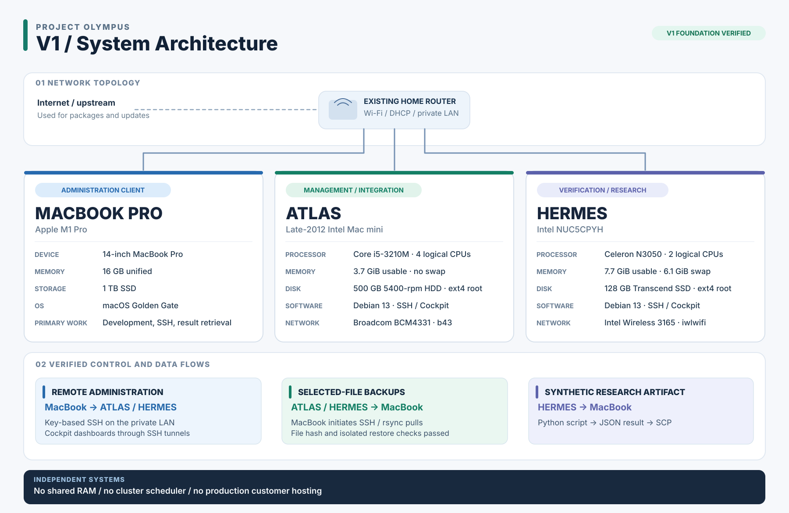

# Project Olympus

**Engineering a practical homelab from repurposed hardware.**

**V1 infrastructure milestone: complete (20 October 2026).** A private, independent two-node Debian Linux laboratory for software verification, small experiments and learning systems engineering.

> **The full illustrated technical case study is being prepared.** This page is the preliminary public project home.

## What is Olympus?

A deliberately small homelab made from existing equipment: **ATLAS** (a late-2012 Intel Mac mini), **HERMES** (an Intel NUC) and a MacBook Pro used for development and administration.

The two servers boot independently, have their own compute and storage, and are administered on a private home network. The lab is designed to support **Project Aula** synthetic development checks and modest **Project Athena** work.

[Explore the illustrated architecture and full specifications](architecture.md) · [V1 verification record](v1-verification.md) · [GitHub repository](https://github.com/AbhimanthaW/olympus-homelab)

[View full-resolution SVG](assets/olympus-v1-architecture.svg)

## What V1 demonstrated

- Independent Debian 13 installations and SSH administration on both nodes.
- Cockpit management interfaces accessed over SSH tunnels.
- Controlled reboots and limited post-power-outage recovery checks.
- Short SMART storage self-tests, manual selected-file off-node backups and isolated file-restore comparisons.
- A tiny synthetic Python/Athena calculation on HERMES with its result retrieved to the MacBook.
## The story I'm documenting

The forthcoming article will cover the original design tradeoffs, installing Debian without a conventional USB installer, bootstrapping the network, troubleshooting firmware and DNS, post-outage validation, backups and what the process taught me.

The original USB-less bootstrap sequence is being reconstructed from primary installation records before publishing a reproducible technical procedure.

---

*Evidence cutoff: 20 October 2026. Public documentation is curated from private operational records, which are not hosted in this repository.* 
